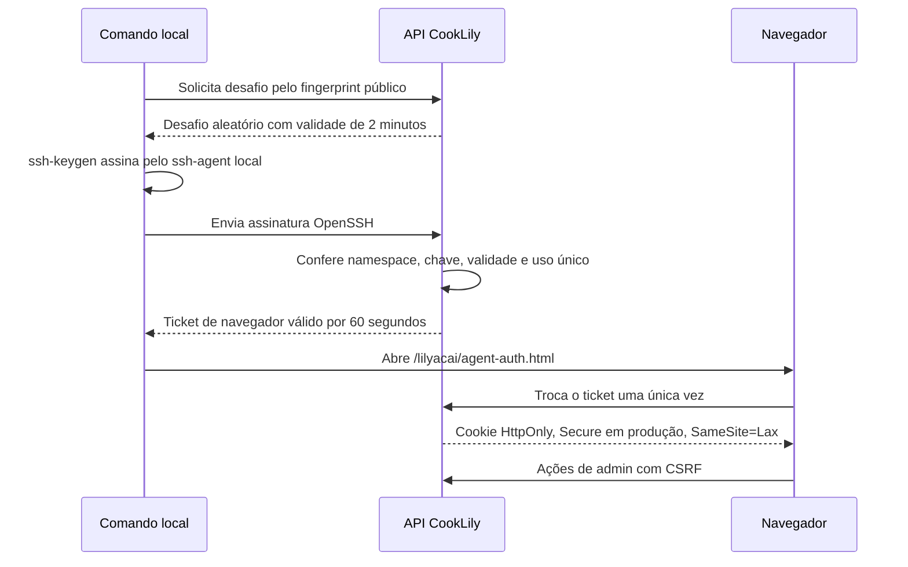

# Acesso de agente CookLily por chave

Status: implementação nesta entrega; provisionamento de produção fica sujeito à integração e deploy desta versão.

## Objetivo e decisão

O agente autentica por chave Ed25519 OpenSSH local, prova de posse assinada e sessão curta de navegador. Há dois usos separados: uma conta admin dedicada para tarefas administrativas e contas `courier` explicitamente marcadas como teste para homologar logística. Nenhum login de agente usa senha humana ou TOTP. A API identifica a sessão como `agent-key`, deixa `mfa.required=false` e não grava `mfaVerifiedAt`; a chave de agente não aparece como TOTP/MFA ativa.

O acesso cobre somente `/lilyacai/*` e `/api/v1/lily/*`. A identidade `admin` recebe o escopo admin; a identidade `courier` marcada como teste só pode usar os fluxos de entregador e não recebe administração. Nenhuma delas concede acesso ao Carro Chefe, ao banco da Central ou à VPS. Para administrar a VPS, continuam valendo as permissões SSH próprias do operador.

## Como o login funciona



O ticket fica no fragmento da URL (não é enviado em requisições HTTP ou cabeçalho Referer) e a página o remove do histórico antes da troca. O servidor guarda somente hashes dos tickets. A sessão expira em duas horas; cada requisição privilegiada valida novamente que a chave continua ativa. A autorização usa a identidade e o escopo do papel, sem solicitar senha ou TOTP. Revogar a chave encerra as sessões e apaga desafios/tickets pendentes.

Cada conta de agente pode ter uma chave ativa. Para escopo admin, o provisionamento exige conta ativa com papel `admin`. Para escopo courier de teste, exige papel `courier` e `isTestAccount=true`. A flag de teste sozinha não muda a autenticação: somente o provisionamento da chave converte a identidade para login `agent-key` sem senha/TOTP e bloqueia senha naquela identidade. Contas de teste sem identidade de agente preservam senha e MFA exigido pelo papel. Couriers reais, staff e admins humanos preservam login e MFA normais. Se um courier agente perder a flag de teste ou mudar de papel, a chave e as sessões são revogadas automaticamente.

As operações administrativas continuam exigindo CSRF. As linhas de `LilyAdminAudit` registram `actorType=agent`, o ID estável da chave e o fingerprint usado. O cadastro e a revogação por operador também deixam auditoria.

## Configuração única no computador do agente

Execute no PowerShell do computador que usará o navegador. Crie uma chave exclusiva; não reutilize a chave que permite SSH à VPS:

```powershell
ssh-keygen -t ed25519 -a 64 -f "$env:USERPROFILE\.ssh\cooklily_agent_ed25519" -C "cooklily-agent"
ssh-add "$env:USERPROFILE\.ssh\cooklily_agent_ed25519"
Get-Content "$env:USERPROFILE\.ssh\cooklily_agent_ed25519.pub" | Set-Clipboard
```

Defina uma frase secreta para a chave quando `ssh-keygen` solicitar e mantenha a chave carregada no `ssh-agent`. A chave privada fica em `.ssh` e nunca deve ser copiada para o repositório, para o chat ou para a VPS.

## Provisionar ou revogar na VPS

Depois que esta versão estiver implantada e `/usr/local/sbin/lily-agent-key` instalado, cadastre a chave pública copiada:

```bash
sudo lily-agent-key register <telefone-da-conta-admin-ou-courier-teste> "ssh-ed25519 AAAA..." "CookLily Codex"
sudo lily-agent-key status <telefone-da-conta-admin-ou-courier-teste>
```

O comando recebe somente a chave pública. Não passe chave privada, senha ou TOTP. Para courier, marque a conta como teste em Painel → Equipe antes de registrar a chave. Use uma chave Ed25519 diferente para cada courier; o agente assina o desafio via `ssh-agent` e não lê a chave privada.

Para encerrar o acesso:

```bash
sudo lily-agent-key revoke <telefone-da-conta-admin-ou-courier-teste>
```

Uma nova chave pode ser cadastrada depois com `register`; esse comando substitui a chave anterior e invalida as sessões existentes.

## Login de rotina

Na raiz do repositório, execute:

```powershell
node tools/lily-agent-auth.mjs login
```

O comando solicita um desafio, assina usando `ssh-agent` e abre o navegador padrão no fluxo CookLily. Não imprime nem salva o ticket. Para uma chave em outro local, use `--key "C:\caminho\da\chave"`.

No Windows, para concluir o handoff no navegador integrado do Codex, defina `$env:COOKLILY_AGENT_BROWSER = "codex"` antes de executar a CLI. Use a aba temporária indicada pela ferramenta; não abra Edge/Chrome externo para esta homologação. O fluxo completo está no [Guia de acessos CookLily](./GUIA_ACESSOS_COOKLILY.md).

## Limites e resposta a incidentes

- Desafio: 2 minutos; até 5 tentativas de assinatura.
- Ticket de navegador: 60 segundos e uma única troca.
- Sessão administrativa do agente: 2 horas; cookie HttpOnly, Secure em produção, SameSite=Lax; alterações exigem CSRF.
- Limites de tentativa são aplicados às rotas de desafio, assinatura e troca.
- A conta dedicada não aceita login por senha enquanto marcada como identidade de agente.
- Em caso de perda/comprometimento do computador, executar `lily-agent-key revoke` pela VPS. Isso invalida imediatamente sessões abertas.
- Não armazenar os códigos da conta humana ou a chave privada em `.env`, arquivos versionados, screenshots ou logs.

## Evidências e critérios de aceite

- Testar assinatura correta/incorreta, replay do desafio/ticket, bloqueio de senha da conta de agente, ação admin com CSRF, auditoria atribuída ao agente, expiração e revogação de sessão.
- Validar migração Lily em banco temporário e no deploy com backup confirmado.
- No domínio real, autenticar pelo comando local, conferir acesso ao painel e realizar operação reversível de teste; conferir auditoria sem alterar pagamentos ou enviar pedidos reais.
- Registrar SHA, IDs de CI, deploy e capturas sem ticket, chave, telefone ou outros dados pessoais.
